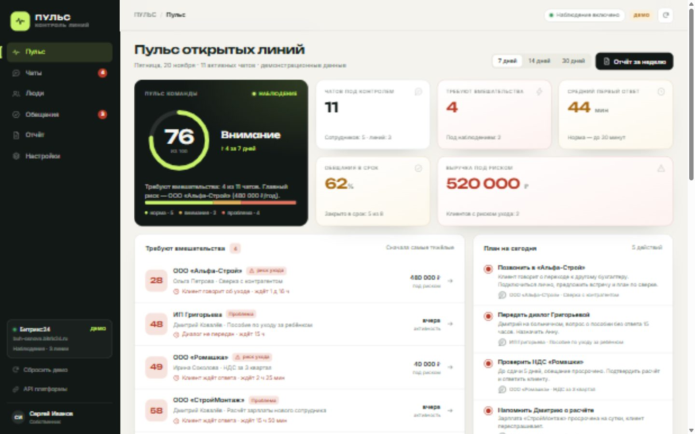
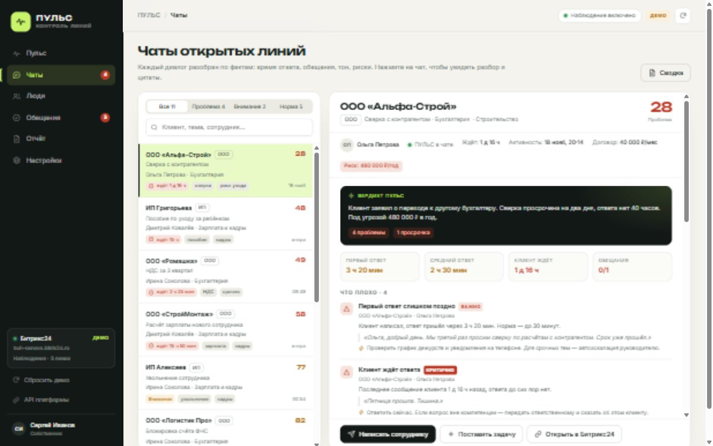
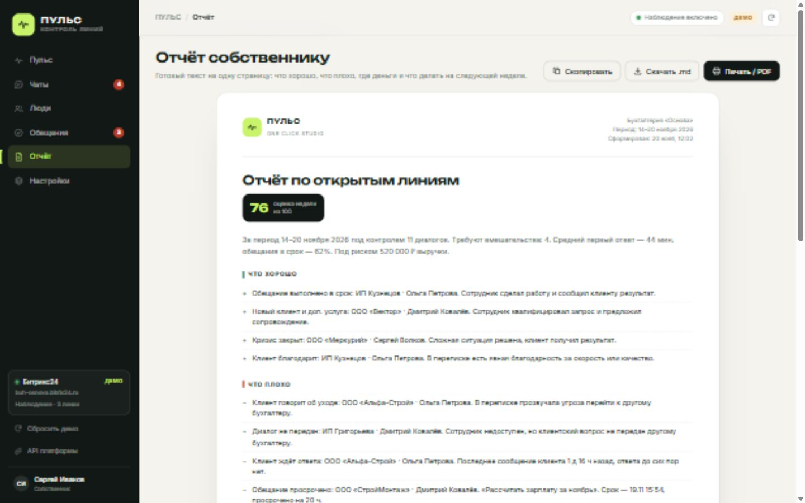

# ПУЛЬС

**AI-контроль открытых линий Битрикс24 для бухгалтерской компании.**

Бот-наблюдатель находится в чатах «клиент + сотрудник», разбирает переписку
и даёт собственнику ответ: что хорошо, что плохо, где теряются клиенты и деньги,
что сделать сегодня.



**PDF для собственника:** [ПУЛЬС — как работает бот](docs/pulse-owner.pdf)

---

## Что внутри

- **Бот-наблюдатель** — читает открытые линии, не отвечает клиенту.
- **Разбор чата** — первый ответ, ожидание, обещания, тон, риски ухода, сроки.
- **Оценка 0–100** — с цитатой и объяснением каждого вывода.
- **Красная зона** — чаты, которые требуют вмешательства сегодня.
- **Люди** — сильные стороны и зоны роста сотрудников.
- **Обещания** — что пообещали, кому и к какому сроку.
- **Отчёт собственнику** — одна страница, печать в PDF, скачивание.
- **Утренняя сводка и пятничный отчёт** — в личный чат.
- **Демо-контур** — 11 чатов, 5 сотрудников, 3 линии, реалистичные сценарии
  бухгалтерии: НДС, УСН, зарплата, кадры, ФНС, сверки.

---

## Быстрый старт

```bash
python -m venv .venv
.venv\Scripts\activate
pip install -r requirements.txt
python run.py
```

Открыть: **http://127.0.0.1:8090**

Пароль не нужен — это демо-контур. Кнопка «Сбросить демо» возвращает исходный
сценарий.

### Windows: запуск в фоне

```powershell
powershell -ExecutionPolicy Bypass -File .\start.ps1
powershell -ExecutionPolicy Bypass -File .\stop.ps1
```

Логи: `data/server.out.log`, `data/server.err.log`.

---

## Демо за 5 минут

1. **Пульс.** Открыть главный экран: оценка 76/100, четыре чата в красной зоне,
   выручка под риском 520 000 ₽.
2. **«Альфа-Строй».** Нажать на первый чат: вердикт, цитата «Пятница прошла.
   Тишина», риск 480 000 ₽ и кнопка «Написать сотруднику».
3. **Обещания.** Показать три просрочки и кнопку «Напомнить».
4. **Люди.** Открыть карточку Анны: 99 баллов, сверки закрыты в тот же день.
5. **Отчёт.** Открыть готовую страницу для собственника и нажать «Печать / PDF».

Главный слайд для собственника: «Вы больше не узнаёте о проблеме последним».

---

## Демо-сценарий

В базе 11 чатов:

| Клиент | Сотрудник | История | Оценка |
|---|---|---|---|
| ООО «Альфа-Строй» | Ольга Петрова | Клиент говорит об уходе, сверка просрочена | 28 |
| ИП Григорьева | Дмитрий Ковалёв | Вопрос без ответа 15 часов, диалог не передан | 48 |
| ООО «Ромашка» | Ирина Соколова | Просрочено обещание по НДС, до сдачи 5 дней | 49 |
| ООО «СтройМонтаж» | Дмитрий Ковалёв | Расчёт зарплаты просрочен на сутки | 58 |
| ООО «Логистик Про» | Ирина Соколова | Долгий первый ответ, но кризис закрыт | 82 |
| ИП Алексеев | Ирина Соколова | Резкий тон в ответе | 76 |
| ИП Кузнецов | Ольга Петрова | УСН, заявление и расчёт за 7 минут | 99 |
| ООО «Вектор» | Дмитрий Ковалёв | Новый клиент, сопровождение 36 000 ₽/мес | 99 |
| ИП Смирнова | Анна Морозова | Сроки, аванс, напоминание | 99 |
| ООО «ТехноПарк» | Анна Морозова | Сверка с ФНС за день | 99 |
| ООО «Меркурий» | Сергей Волков | Личное вмешательство руководителя | 99 |

Сводка: пульс 76/100, 4 чата требуют вмешательства, 2 клиента под риском
на 520 000 ₽.

---

## Экраны

- **Пульс** — оценка, KPI, красная зона, план на сегодня, динамика, команда,
  что хорошо и что плохо.
- **Чаты** — список с фильтрами и поиском; разбор, обещания, переписка с пометками.
- **Люди** — карточки сотрудников, сильные стороны, зоны роста, сравнение.
- **Обещания** — статусы, просрочки, напоминания.
- **Отчёт** — готовый документ для собственника.
- **Настройки** — подключение, режим присутствия, правила, уведомления, доступы.




---

## Архитектура

```
app/
  main.py       FastAPI: панель, API, webhook
  config.py     настройки из окружения
  db.py         SQLAlchemy + SQLite/PostgreSQL
  models.py     employee, client, chat, message, finding, promise, task,
                metric_day, setting, action_log
  seed.py       демо-сценарий бухгалтерской компании
  analysis.py   движок разбора: метрики, находки, оценка
  api.py        срез для панели, действия, отчёт
  ui/           панель без сборки: HTML + CSS + JS
docs/
  01-КАК-РАБОТАЕТ-БОТ.md      описание для собственника
  02-ТЗ.md                     техническое задание
  03-ИНТЕГРАЦИЯ-БИТРИКС24.md  подключение бота и REST
  04-МЕТОДИКА-ОЦЕНКИ.md        правила и формула
  05-ПИЛОТ.md                  план проверки за 14 дней
  owner-brief.html             вёрстка PDF для собственника
  pulse-owner.pdf              PDF для собственника
scripts/
  make_owner_pdf.py            пересборка PDF из owner-brief.html
```

Платформа выросла из наработок проекта `bot_dely_site`: тот же стек
(FastAPI + SQLAlchemy + SQLite + панель без сборки), та же дизайн-система
One Click, тот же подход «демо-сценарий + объяснимый разбор + версии правил».
Логика бота переработана под контроль открытых линий, а не под ответы клиентам.

---

## Интеграция с Битрикс24

В демо-контуре события имитируются. Для боевого подключения:

1. Создать локальное приложение со scope `imbot`, `imopenlines`, `tasks`, `crm`, `user`.
2. Зарегистрировать бота `imbot.v2.Bot.register` с `type=supervisor`,
   `isSupportOpenline=true`.
3. Подключить к открытой линии.
4. Принимать `ONIMBOTV2MESSAGEADD` на `/webhook/bitrix24`.
5. Читать историю через `imopenlines.session.history.get`.

Подробно, с примерами запросов и чек-листом: `docs/03-ИНТЕГРАЦИЯ-БИТРИКС24.md`.

---

## Переменные окружения

| Переменная | Назначение |
|---|---|
| `COMPANY_NAME` | Название компании в интерфейсе |
| `OWNER_NAME` | Имя собственника |
| `DEMO_MODE` | `1` — демо-контур |
| `BITRIX24_DOMAIN` | Домен портала |
| `BITRIX24_WEBHOOK` | Входящий webhook |
| `BITRIX24_BOT_ID` | ID зарегистрированного бота |
| `BITRIX24_LINES` | Список линий |
| `DATABASE_URL` | SQLite или PostgreSQL |
| `FIRST_RESPONSE_WARN` | Порог первого ответа, минуты |
| `WAITING_WARN` | Порог ожидания, минуты |

---

## API

- `GET /api/state?period=7` — срез для панели.
- `GET /api/chats/{id}` — детали чата.
- `POST /api/chats/{id}/notify` — сообщение сотруднику.
- `POST /api/chats/{id}/task` — задача.
- `POST /api/settings` — настройки.
- `POST /api/demo/reset` — пересобрать демо.
- `POST /webhook/bitrix24` — события портала.
- `GET /api/docs` — OpenAPI.

---

## Важно

- Это демонстрационный контур: данные вымышлены, налоговые сроки приведены
  как пример и не являются консультацией.
- Бот не отвечает клиентам и не считает налоги.
- Оценки — инструмент коучинга, а не автоматическое наказание.
- Перед боевым запуском нужны согласие команды, политика хранения данных
  и проверка на пилотной линии.

---

## Лицензия и авторство

Внутренний продукт One Click Studio. Дизайн-система и шрифты — по лицензиям
из `app/ui/fonts/`.
